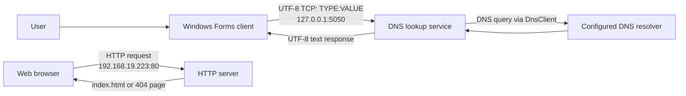

# DNS Lookup Client and HTTP Server

A computer networks project with a Windows Forms DNS lookup client, a TCP lookup service, and a separate HTTP server. All three are C# projects targeting **.NET Framework 4.7.2**.

## Architecture



The HTTP server is independent of the DNS client and lookup service. The client's **Open Website** button asks the system browser to open `http://` plus the text in the input box; it does not route through `ServerHTTP`.

| Component | Source | Responsibility |
| --- | --- | --- |
| Windows Forms client | [`WindowsFormsApp1client/WindowsFormsApp1client/WindowsFormsApp1client/`](WindowsFormsApp1client/WindowsFormsApp1client/WindowsFormsApp1client/) | Collects a record type and domain/IP, sends one TCP query, displays the response. |
| DNS lookup service | [`ConsoleApp4dnsserver/ConsoleApp4dnsserver/`](ConsoleApp4dnsserver/ConsoleApp4dnsserver/) | Listens on TCP port 5050, parses the query, resolves it with DnsClient, returns text. |
| HTTP server | [`ServerHTTP/ServerHTTP/`](ServerHTTP/ServerHTTP/) | Uses `HttpListener` to serve the same `index.html` for requests to its configured prefix. |

### DNS request flow

1. Select `A`, `MX`, `CNAME`, or `PTR` and enter a domain name or IP address.
2. The client connects to `127.0.0.1:5050` and sends UTF-8 text such as `A:example.com` or `PTR:8.8.8.8`.
3. The service splits on `:`, runs a DnsClient lookup using the machine's configured DNS resolver, and joins matching answers with commas.
4. The service writes a UTF-8 text response and closes the connection. The client displays that response.

This is a **custom TCP text protocol**, not a standard DNS server on port 53. The service handles one connection at a time. Both sides read at most 1,024 bytes once; there is no message framing or retry logic.

| Type | Input | Output |
| --- | --- | --- |
| `A` | Domain | IPv4 addresses |
| `MX` | Domain | Mail exchangers and priorities |
| `CNAME` | Domain | Canonical names |
| `PTR` | IP address | Reverse DNS names |

Invalid query format, unsupported types, and lookup failures return plain-text messages. A lookup response is displayed even when it contains an error message.

## Requirements

- Windows with .NET Framework 4.7.2 runtime and developer/targeting pack.
- Visual Studio with the **.NET desktop development** workload, or MSBuild with NuGet restore support.
- Network access to a DNS resolver for lookups.
- For the HTTP project, the machine must own the configured IP address and allow binding to port 80.

The DNS service uses `DnsClient` 1.8.0 and `System.Buffers` 4.5.1, declared in [`packages.config`](ConsoleApp4dnsserver/ConsoleApp4dnsserver/packages.config). The `packages/` directory is generated during NuGet restore and is ignored by Git.

## Build and run

These are **three separate Visual Studio solutions**. Open and build each `.sln` file in Visual Studio. Restore NuGet packages when prompted for the DNS service.

1. Build and start [`ConsoleApp4dnsserver.sln`](ConsoleApp4dnsserver/ConsoleApp4dnsserver.sln). Leave its console open; it listens on all interfaces on TCP port `5050`.
2. Build and start [`WindowsFormsApp1client.sln`](WindowsFormsApp1client/WindowsFormsApp1client/WindowsFormsApp1client.sln) on the same machine. Enter `example.com`, select `A`, then click **Lookup**.
3. To try the separate web server, edit the `HttpListener` prefix in [`ServerHTTP/ServerHTTP/Program.cs`](ServerHTTP/ServerHTTP/Program.cs) to an address assigned to your machine. Build and start [`ServerHTTP.sln`](ServerHTTP/ServerHTTP.sln), then open that address in a browser. The source [`index.html`](ServerHTTP/ServerHTTP/index.html) is copied to the output folder during build.

The HTTP prefix is currently hardcoded as `http://192.168.19.223:80/`. Windows may require administrator rights or a URL ACL reservation to bind that prefix. `index.html` is loaded from the **process working directory**, so run the HTTP executable from its output folder. A missing file returns a 404 HTML page.

## Current limitations

- Client and DNS service addresses/ports are hardcoded. The client expects the service on the same machine.
- Lookup and network I/O run synchronously, so the client window can pause while waiting for a response.
- The DNS service is single-threaded and accepts one query per TCP connection.
- TCP reads assume each request and response arrives in one read and fits in 1,024 bytes.
- The HTTP server uses one fixed prefix and serves one static page for every path. Its `q` exit check runs between requests; while waiting for a request, it cannot process the key.
- The **Open Website** button opens the entered text as an HTTP host. It does not verify a successful DNS result and is not useful for PTR input.

## Repository layout

```text
ConsoleApp4dnsserver/   TCP DNS lookup service, solution, NuGet manifest
ServerHTTP/             Standalone HTTP server and source index.html
WindowsFormsApp1client/ Windows Forms client and designer resources
README.md               Project and architecture guide
.gitignore              Visual Studio, build, and restored package exclusions
```

## GitHub setup

Run these commands **from this project folder**. It has its own Git repository, so files from the parent directory are not included:

```powershell
cd 'D:\UET LAHORE\2nd Semester\cn project'
git add README.md .gitignore ConsoleApp4dnsserver ServerHTTP WindowsFormsApp1client
git status --short
git commit -m "Add network project source and documentation"
git branch -M main
git remote add origin https://github.com/YOUR-USERNAME/YOUR-REPOSITORY.git
git push -u origin main
```

Replace the remote URL with your empty GitHub repository URL. Review `git status --short` before committing; generated `bin/`, `obj/`, and `packages/` directories should not appear.
